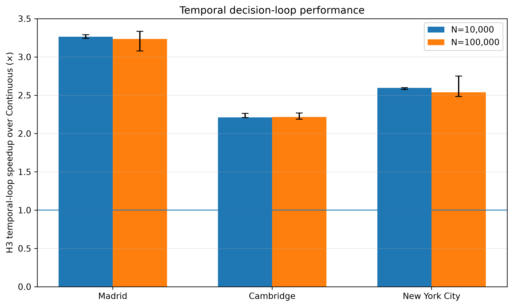
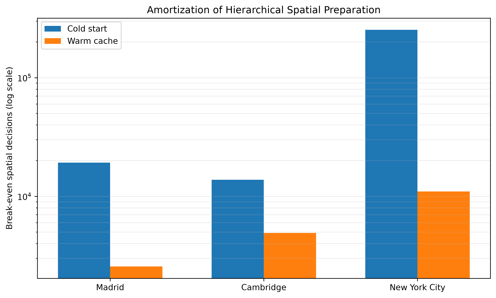

# H3 Urban Architecture Benchmark

A reproducible **multi-city benchmark for scalable urban simulation with H3**, comparing a continuous spatial-indexed backend with a multi-resolution H3 backend while preserving a common physical mobility layer.

> **Research question:** How much computational efficiency can a hierarchical H3 representation provide for large-scale urban agent simulation, and how much urban fidelity is retained across spatial scales?

The current benchmark covers **Madrid, Cambridge (MA), and New York City**. Isolated architectural workloads scale to **1,000,000 queries**, while the temporal end-to-end benchmark evaluates **10,000 and 100,000 agents** under a common five-decision schedule.

---

## 1. What this repository evaluates

The framework deliberately separates four experimental questions.

### Architectural efficiency
The Continuous and H3 backends are benchmarked on:
- pure spatial lookup;
- urban-context retrieval;
- accessibility queries;
- candidate retrieval;
- full agent decision.

The architecture sweep scales from **10K to 1M agents/queries**.

### Architectural agreement
At `N = 10,000`, paired Continuous/H3 simulations measure architectural agreement between the Continuous and H3 representations using:
- accessibility correlation;
- destination spatial equivalence;
- trip-distance fidelity;
- OD-flow similarity at H7/H8/H9;
- final occupancy similarity at H7/H8/H9;
- amenity-usage agreement.

### Temporal end-to-end performance and amortization
A separate temporal benchmark evaluates the complete repeated decision loop at **10K and 100K agents**. The schedule produces **five spatial decisions per agent** in all three cities. The experiment reports paired-median temporal-loop speedup, cold- and warm-total speedup, and break-even in **spatial decisions**.

The repetition protocol is **3 repeats at 10K agents** and **5 repeats at 100K agents** for each city. Break-even is reported primarily in decisions because the five-decision schedule is an experimental protocol rather than a universal property of an agent.

### Physical-network realization
Representative paired origin-destination decisions are projected onto the **same real OpenStreetMap walking graph**. Routing is deliberately *not* part of the H3 speedup claim.

---

## 2. Architectural rules

1. **H7/H8/H9 are urban-analysis and fidelity scales.**
2. **H11/H12 are localization/visualization layers only** and never enter the fidelity claim.
3. **Physical routing is not discretized with H3.**
4. Both backends use the **same OSM physical network** for route visualization.
5. Heatmaps aggregate real agent/destination coordinates at H7/H8/H9.
6. Speedup therefore measures the spatial-computational representation, not a replacement of street-network routing.

---

## 3. Cross-city benchmark

| City | Raw OSM POIs | Semantic POIs | Population H3 cells | Represented population | OSM graph nodes | OSM graph edges |
|---|---:|---:|---:|---:|---:|---:|
| Madrid | 38,949 | 38,949 | 2,037 | 2,337,708 | 122,237 | 373,234 |
| Cambridge, MA | 7,831 | 2,102 | 175 | 103,855 | 20,322 | 54,756 |
| New York City | 305,387 | 126,595 | 6,747 | 8,037,287 | 361,278 | 1,108,754 |

These cities provide substantially different spatial scales, POI densities, network sizes and urban morphologies.

---

## 4. Headline computational results at 1M queries

Speedup = `continuous execution time / H3 execution time`.

| Operation | Madrid | Cambridge | New York City |
|---|---:|---:|---:|
| Spatial lookup | **47.49x** | **29.95x** | **38.97x** |
| Urban context retrieval | **26.60x** | **16.19x** | **18.35x** |
| Accessibility query | **83.70x** | **50.24x** | **43.44x** |
| Candidate retrieval | **42.03x** | **40.22x** | **41.63x** |
| Full agent decision | **4.21x** | **2.86x** | **3.27x** |

The important result is not one maximum number: the H3 architecture remains faster across all three cities and all five computational operations, including the end-to-end agent decision.

### Full-agent decision latency at 1M

| City | Continuous | H3 | Speedup |
|---|---:|---:|---:|
| Madrid | 75.67 us/query | 17.97 us/query | 4.21x |
| Cambridge | 62.96 us/query | 22.01 us/query | 2.86x |
| New York City | 51.39 us/query | 15.72 us/query | 3.27x |

### Temporal end-to-end results

The 1M-query architecture benchmark above isolates computational operations. The temporal benchmark is a separate end-to-end experiment at **10K and 100K agents**, with five spatial decisions per agent.

| City | Agents | Temporal speedup | Cold total | Cold BE | Warm total | Warm BE |
|---|---:|---:|---:|---:|---:|---:|
| Madrid | 10K | **3.26x** | **1.82x** | 17.2K | **3.21x** | 0.3K |
| Madrid | 100K | **3.24x** | **2.98x** | 19.2K | **3.20x** | 2.6K |
| Cambridge | 10K | **2.21x** | **1.79x** | 9.8K | **2.19x** | 0.7K |
| Cambridge | 100K | **2.22x** | **2.15x** | 13.7K | **2.20x** | 4.9K |
| New York City | 10K | **2.60x** | **0.28x** | 265.9K | **2.06x** | 7.3K |
| New York City | 100K | **2.54x** | **1.43x** | 252.6K | **2.49x** | 11.0K |

`Temporal speedup` is the paired median of Continuous/H3 runtime ratios. `Cold total` includes substrate construction; `Warm total` reuses the precomputed substrate. BE denotes break-even in thousands of spatial decisions.

The cold-start results deliberately retain the operating regime in which H3 does not pay off: for New York City at 10K agents, substrate construction outweighs runtime savings (`0.28x`), whereas at 100K agents the cold-start total crosses into a net gain (`1.43x`).

---

## 5. Architectural agreement at 10K agents

| Metric | Madrid | Cambridge | New York City |
|---|---:|---:|---:|
| Accessibility Pearson | 0.9905 | 0.9796 | 0.9917 |
| Exact destination match | 0.6384 | 0.5922 | 0.6485 |
| Destination within 500 m | 0.8834 | 0.7937 | 0.8229 |
| Destination within 1,000 m | 0.9786 | 0.9524 | 0.9306 |
| Trip-distance Pearson | 0.8834 | 0.8265 | 0.8964 |
| OD flow H7 Pearson | 0.9990 | 0.9989 | 0.9945 |
| OD flow H8 Pearson | 0.9891 | 0.9758 | 0.9584 |
| OD flow H9 Pearson | 0.9168 | 0.8969 | 0.8328 |
| Occupancy H7 Pearson | 0.9928 | 0.9972 | 0.9840 |
| Occupancy H8 Pearson | 0.9174 | 0.8452 | 0.8370 |
| Occupancy H9 Pearson | 0.7528 | 0.6446 | 0.6991 |
| Amenity usage Pearson | 1.0000 | 1.0000 | 1.0000 |

The scale effect is clear: **city-scale agreement is extremely high at H7, neighborhood-scale agreement remains strong at H8, and finer local allocation differences become more visible at H9.** These metrics quantify agreement between the two computational architectures under the paired protocol; they are not validation against external ground truth. Amenity-usage Pearson = 1.0 is retained as a consistency control rather than independent evidence of fidelity.

---

## 6. Main paper figures

The paths below follow the current cross-city output convention.

### Cross-city computational speedup


### Full-agent decision scaling


### Resolution-dependent urban fidelity


### Accessibility speedup versus fidelity


### Temporal end-to-end speedup



### Cold/warm break-even



> If your local analysis script writes these images to a different subdirectory, change only the Markdown image paths; the numerical master tables remain the source of truth.

---

## 7. Physical route visualization

Representative OD routes are projected over the common OSM walking network. Current paper assets include:

### OD Madrid 


### OD Cambridge 


### OD New York 


They represent:
- **New York City:** Manhattan / Midtown zoom;
- **Cambridge:** Kendall / Volpe-area zoom;
- **Madrid:** street-level local zoom.

These maps are **not routing-performance comparisons**. They visualize how destination differences produced by the spatial architectures propagate to physically realizable paths over identical routing infrastructure.

---

## 8. Repository structure

```text
madrid_h3_urban_benchmark/
├── analysis/
│   ├── 04_final_madrid_visual_analysis.py
│   ├── 05_cross_city_paper_analysis.py
│   ├── 06_master_cross_city_analysis.py
│   └── run_all_analysis.py
├── configs/
├── data/
│   ├── raw/                  # Madrid raw data; ignored
│   ├── processed/            # Madrid generated data; ignored
│   ├── cache/                # Madrid caches; ignored
│   ├── cambridge_ma/
│   │   ├── raw/
│   │   ├── processed/
│   │   └── cache/
│   └── new_york_ny/
│       ├── raw/
│       ├── processed/
│       └── cache/
├── experiments/
│   ├── 00_city_smoke_test.py
│   ├── 00_semantic_city_check.py
│   ├── 01_architecture_benchmark.py
│   ├── 02_end_to_end_benchmark.py
│   └── 03_urban_fidelity.py
├── outputs/
│   ├── architecture/
│   ├── urban_fidelity/
│   ├── cambridge_ma/
│   ├── new_york_ny/
│   └── cross_city/
├── scripts/
├── src/h3uab/
├── tests/
├── README.md
└── requirements.txt
```

Large raw rasters, GraphML networks and binary caches should remain outside Git tracking.

---

## 9. Installation

```bash
git clone <YOUR_REPOSITORY_URL>
cd madrid_h3_urban_benchmark

python -m venv .venv
source .venv/bin/activate
pip install -r requirements.txt
```

---

## 10. Build city data

### Cambridge, Massachusetts

The builder prepares the municipal boundary, OSM walking graph, OSM POIs, WorldPop raster, clipped population raster and H3 r9 population aggregation.

```bash
python scripts/build_cambridge_data.py \
  --worldpop-url "https://data.worldpop.org/GIS/Population/Global_2000_2020_Constrained/2020/BSGM/USA/usa_ppp_2020_UNadj_constrained.tif"
```

Verify it with:

```bash
python scripts/smoke_test_cambridge.py
```

### New York City

```bash
python scripts/build_new_york_data.py
python scripts/smoke_test_new_york.py
```

A successful build produces the boundary, walking graph, OSM POIs, clipped WorldPop raster and H3 population file.

---

## 11. Semantic normalization

Raw OSM tags are normalized into semantic urban layers (`D3`-`D25`).

| Layer | Meaning |
|---|---|
| D3 | Retail Store |
| D4 | Commercial |
| D5 | Education |
| D8 | Healthcare |
| D14 | Headquarter Office |
| D15 | Grocery-Market |
| D16 | Recreation & Fitness |
| D17 | Pharmacy |
| D19 | Daycare Center |
| D20 | Coworking Office |
| D21 | Restaurant |
| D22 | Cafe |
| D23 | Bar |
| D24 | Pub |
| D25 | Park |

Check normalization with:

```bash
python experiments/00_semantic_city_check.py --city cambridge_ma
python experiments/00_semantic_city_check.py --city new_york_ny
```

---

## 12. Core smoke test

Before a large benchmark:

```bash
python experiments/00_city_smoke_test.py --city cambridge_ma --agents 1000
python experiments/00_city_smoke_test.py --city new_york_ny --agents 1000
```

The smoke test verifies world construction, both computational backends and paired decisions.

---

## 13. Architecture benchmark

One population:

```bash
python experiments/01_architecture_benchmark.py \
  --city new_york_ny \
  --agents 10000 \
  --repeats 3
```

Complete 10K-to-1M sweep:

```bash
python experiments/01_architecture_benchmark.py \
  --city new_york_ny \
  --agents 10000 100000 500000 1000000 \
  --repeats 3
```

The experiment reports Continuous and H3 latency, throughput and speedup. Routing is excluded because it is common physical infrastructure.

---

## 14. Temporal end-to-end experiment

Run the temporal decision-loop benchmark separately from the 1M architecture sweep.

```bash
python experiments/02_end_to_end_benchmark.py --city madrid --agents 10000 --repeats 3 --static-city-mode both
python experiments/02_end_to_end_benchmark.py --city madrid --agents 100000 --repeats 5 --static-city-mode both
```

Repeat with `cambridge_ma` and `new_york_ny`. The temporal protocol generates five spatial decisions per agent in all three cities. Semantic diversity can differ with each city's active-layer coverage and schedule fallbacks even though the decision count is held constant.

The benchmark distinguishes temporal runtime, cold preparation, warm preparation, cold/warm total time, and break-even. Temporal speedup is summarized using the **median of paired per-repeat speedup ratios**. Break-even is computed from aggregated median per-decision costs and median preparation times, with sensitivity bounds derived from observed per-decision extrema.

---

## 15. Architectural-agreement experiment

```bash
python experiments/03_urban_fidelity.py \
  --city new_york_ny \
  --agents 10000
```

Supported city keys are:

```text
madrid
cambridge_ma
new_york_ny
```

The fidelity run produces a summary and diagnostics including:

```text
destination_separations.csv
paired_trip_endpoints.csv
occupancy_H7.csv
occupancy_H8.csv
occupancy_H9.csv
visit_density_H7.csv
visit_density_H8.csv
visit_density_H9.csv
od_flows_H7.csv
od_flows_H8.csv
od_flows_H9.csv
```

The paired endpoint diagnostic allows representative routes to be realized over the common real OSM walking graph without repeating the architecture sweep.

---

## 16. Master cross-city tables

After completing the three cities:

```bash
python analysis/06_master_cross_city_analysis.py
```

Generated files:

```text
outputs/cross_city/
├── MASTER_cross_city_full.csv
├── city_characteristics_long.csv
├── computational_performance_1M_long.csv
├── fidelity_10K_long.csv
├── end_to_end_temporal_long.csv
├── TABLE_1_city_characteristics.csv
├── TABLE_2_computational_performance_1M.csv
├── TABLE_3_fidelity_10K.csv
├── TABLE_4_end_to_end_temporal_amortization.csv
├── TABLE_4_end_to_end_temporal_amortization.tex
└── TABLE_PAPER_cross_city_summary.csv
```

These are the numerical source for the paper's experimental tables.

---

## 17. Generate figures

For the analysis pipeline:

```bash
python analysis/run_all_analysis.py
```

The visualization convention is intentional:
- Continuous and H3 heatmaps use the **same color scale**;
- difference maps are **zero-centered and symmetric**;
- H7 represents city-scale structure;
- H8 represents neighborhood-scale structure;
- H9 exposes finer local-allocation divergence.

---

## 18. Reproducibility workflow

```text
Build/download municipal data
            |
            v
Validate boundary + OSM graph + POIs + population
            |
            v
Normalize POIs into D3-D25 semantic layers
            |
            v
Run 1K-agent smoke test
            |
            v
Architecture sweep: 10K -> 100K -> 500K -> 1M
            |
            v
Paired architectural-agreement validation at 10K
            |
            v
Temporal end-to-end: 10K (3 repeats) + 100K (5 repeats)
            |
            v
Cold/warm amortization analysis
            |
            v
Generate city visual diagnostics
            |
            v
Generate master cross-city tables
            |
            v
Generate publication figures
```

Expensive raw-data preparation and architecture sweeps therefore do **not** need to be repeated simply to regenerate paper figures.

---

## 19. How to interpret the experiment

### Supported by the benchmark

The experiments test whether hierarchical H3 indexing can reduce the computational cost of repeated urban spatial queries while preserving aggregate urban patterns.

The current three-city results show:
- substantial speedups in every tested spatial operation;
- strong end-to-end full-agent decision acceleration;
- very high H7 OD/occupancy agreement;
- strong H8 fidelity;
- increasing local divergence at H9;
- identical city-level amenity-usage correlation in the paired experiments.

### Not claimed

The benchmark does **not** claim that:
- H3 replaces the physical street network;
- H3 routing is faster than OSM routing;
- H11/H12 provide additional urban-analysis fidelity;
- exact destination identity is always preserved;
- fine-scale H9 allocation is identical to the Continuous backend.

The central claim is a **speed-fidelity trade-off for spatial computation**, evaluated independently from physical routing.

---

## 20. Data provenance and Git policy

The project uses real geospatial infrastructure including OpenStreetMap-derived POIs and walking networks, WorldPop population rasters, municipal boundaries and H3 hierarchical spatial indexing.

Raw and generated geospatial assets are intentionally excluded from Git because some files are hundreds of megabytes or larger. The repository should contain the **builders, algorithms, experiments, compact result tables and publication figures** needed to reproduce and audit the work.

---

## 21. Current experimental status

| Component | Madrid | Cambridge | NYC |
|---|:---:|:---:|:---:|
| City data | Yes | Yes | Yes |
| Semantic normalization | Yes | Yes | Yes |
| OSM walking graph | Yes | Yes | Yes |
| Architecture benchmark to 1M | Yes | Yes | Yes |
| Architectural agreement at 10K | Yes | Yes | Yes |
| Temporal end-to-end at 10K | Yes | Yes | Yes |
| Temporal end-to-end at 100K | Yes | Yes | Yes |
| Cold/warm preparation analysis | Yes | Yes | Yes |
| Break-even analysis | Yes | Yes | Yes |
| Cross-city master tables (Tables 1-4) | Yes | Yes | Yes |
| Paper visual analysis (CC1-CC6) | Yes | Yes | Yes |

The repository is now a **three-city cross-city validation framework**, not a Madrid-only benchmark.

---

## 22. Scientific-analysis package

The former scientific-analysis README described the frozen experiment as three components: architectural efficiency, urban fidelity and spatial visualization. It also established the crucial rules that H11/H12 are localization/visualization only and that real OSM mobility is common infrastructure.

Those principles are now consolidated here so the repository can use **one authoritative README**.

---

## Citation

If you use this repository in academic work, cite the associated paper once its final bibliographic information is available.

## License

Add the repository license here when finalized.
